# CYBERVERSE — Décision finale sur les personnages (Phase 2C)

Date : 22/11/2026

**Statut : les deux personnages jouables sont terminés et validés sur leurs copies de production.**

| Rôle | Personnage | Fichier de production | Taille | Validation |
|---|---|---|---|---|
| **Homme** | **Cyber JT — édition CYBERVERSE** | `public/assets/characters/cyber-jt/cyber-jt.cv.vrm` | 3,53 Mo (original : 15,55 Mo) | ✔ rendu, visage, repos / marche / course, contact au sol, déformations, performance |
| **Femme** | **NEON FIGHTER + — édition CYBERVERSE** | `public/assets/characters/neon-fighter/neon-fighter.cv.vrm` | 4,88 Mo (original : 17,86 Mo) | ✔ mêmes tests |
| Animations | 21 clips UAL humanoïdes | `public/assets/animations/ual-humanoid-clips.json` | 1,71 Mo (JSON non compressé) | ✔ testées sur les deux personnages |

Les fichiers téléchargés d'origine sont intacts. Leurs empreintes SHA-256 sont identiques avant et après le travail :
- Cyber JT : `7c53453a…`
- NEON FIGHTER + : `1ed34484…`
- Robert : `dee6c683…`
- Julieta : `a612968e…`

Robert et Julieta sont abandonnés, comme demandé.

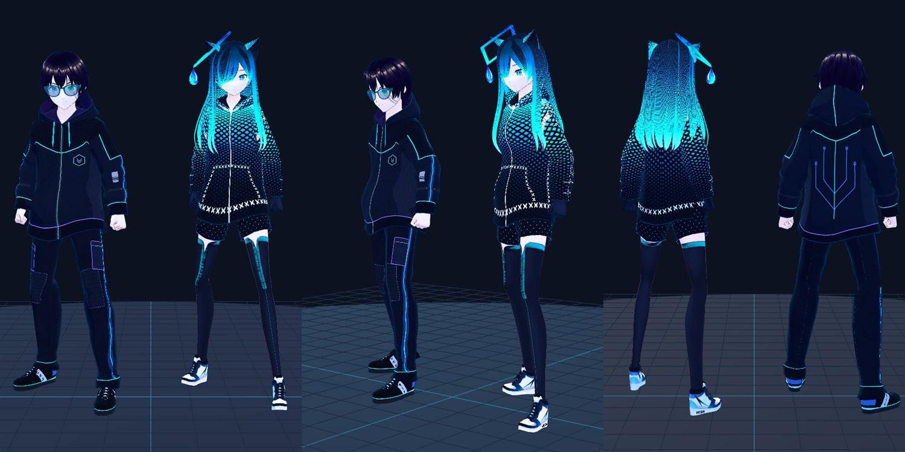

---

## 1. Ce qui a été fait

### 1.1 Correction du diagnostic de la Phase 2B (NEON FIGHTER +)
En Phase 2B, j'avais décrit deux défauts du modèle : un rectangle sombre autour de la goutte et un trait flottant au-dessus de la tête. **C'était une erreur de mon outil de validation, pas un défaut du modèle.**

- **Cause réelle.** Mon banc de test n'appelait jamais `vrm.update()`. Or three-vrm ne transmet au shader MToon le seuil de découpe alpha (`alphaTest`) que dans cette fonction. Les pixels transparents de la mèche portant la goutte s'affichaient donc en noir opaque : le rectangle autour de la goutte, et le trait au bout de la même mèche, à 2,12 m.
- **Preuve.** Un rendu identique avec et sans `vrm.update(0)` :

  | Sans `vrm.update()` | Avec `vrm.update()` |
  |---|---|
  | 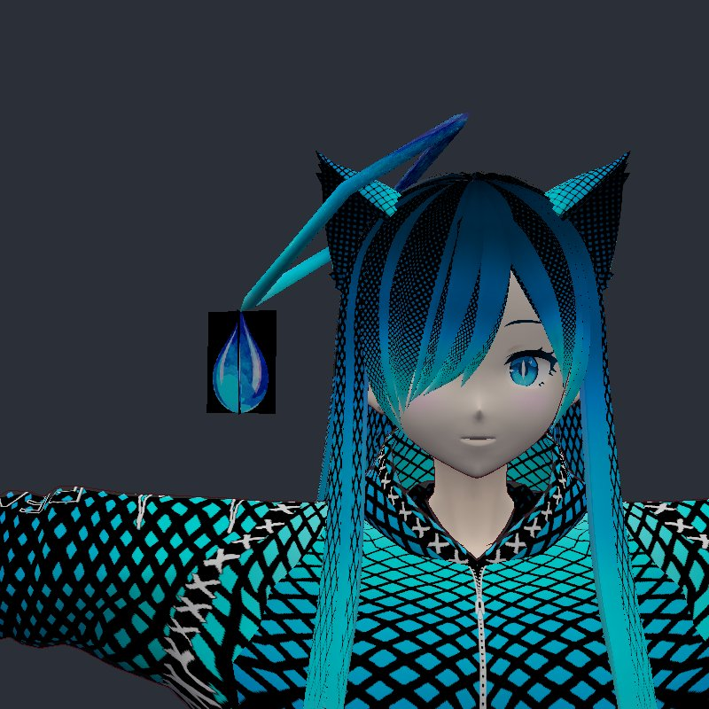 | 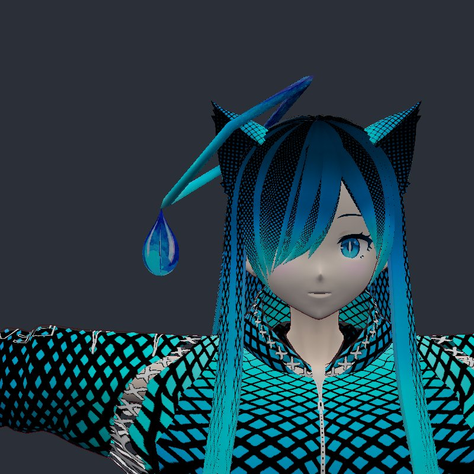 |

- **Correction à la source.** Le banc de test et le module de l'application (`src/cyberverse/characters/character.js`) appellent désormais `vrm.update()` avant le premier rendu, puis à chaque image. La règle est documentée dans le code.
- **Correction géométrique complémentaire.** La partie entièrement transparente de cette mèche (8 triangles et 12 sommets) a été supprimée de la copie de production. Rien ne change à l'image, mais la boîte englobante redevient juste : 1,89 m au lieu de 2,12 m, ce qui compte pour le cadrage et les collisions.

### 1.2 Cyber JT : refonte en techwear
Le sweat et le jean décontractés deviennent une **veste-coque technique à capuche** et un **pantalon cargo technique**. Le visage, les yeux vairons, les marques du visage, la coiffure, les proportions et le squelette sont inchangés.

Méthode : chaque texture est recalculée dans l'espace UV à partir de la **position 3D réelle et de la normale de chaque texel sur le corps**. Le design suit donc le vêtement comme une vraie couture, au lieu d'être peint à plat. Les détails ajoutés :
- **Veste** : tissu ripstop marine ; empiècement d'épaules plus sombre à micro-motif hexagonal, souligné d'un passepoil cyan lumineux (en V sur le devant, prolongé sur le haut des manches) ; fermeture centrale ; emblème hexagonal cyan et violet sur la poitrine, à la place du logo vert ; tracés de circuit dans le dos ; bande bleu électrique à cœur lumineux sur les manches ; sangle d'avant-bras à deux LED ; étiquette réfléchissante type code-barres ; poignets et ourlet côtelés, avec un liseré cyan pour les poignets et violet pour l'ourlet ; doublure de capuche violette et couture centrale lumineuse ; cordons « fibre optique ».
- **Pantalon** : marine presque noir ; bande latérale bleu électrique à cœur cyan ; genouillères articulées matelassées à surpiqûre en pointillés ; poche cargo sur la cuisse avec un contour violet et un rabat ; ceinture avec boucle lumineuse ; chevilles resserrées soulignées de cyan. Le motif tribal d'origine est effacé.
- **Chaussures** : noires, semelle soulignée d'un trait cyan lumineux, talon bleu électrique.
- **Lunettes** : verres teintés d'un dégradé cyan-violet, monture métal légèrement lumineuse.
- **Matériaux** : rendu MToon commun aux deux personnages (ombres froides, liseré de lumière bleuté, contours marine) et cartes d'émission dédiées.

| Original | Édition CYBERVERSE |
|---|---|
| 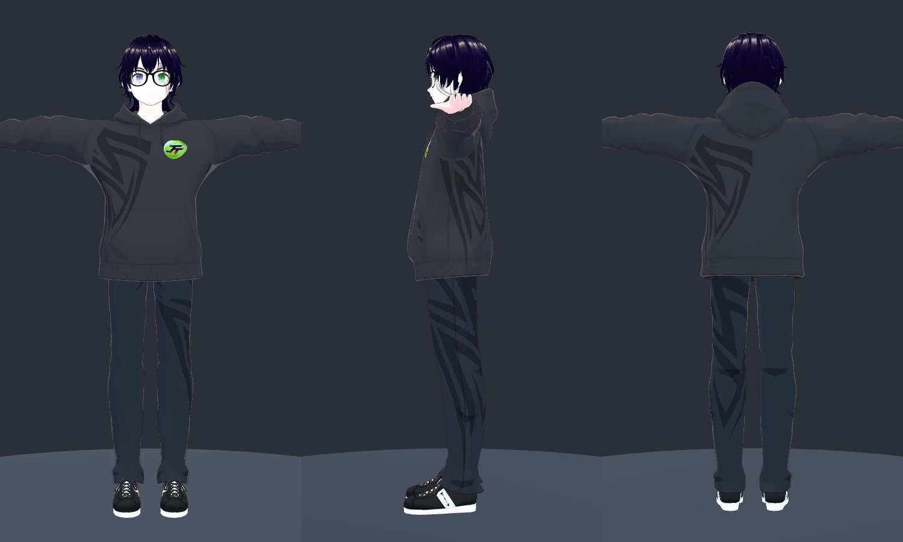 | 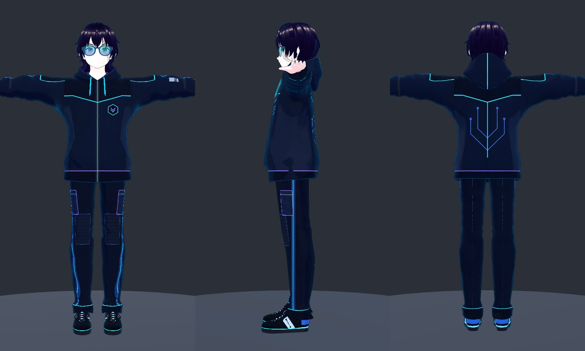 |

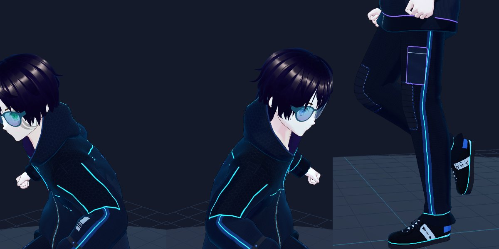

### 1.3 NEON FIGHTER + : finition
Elle avait déjà la palette demandée et une identité forte : sweat à losanges cyan, imprimé « PEACE » et battement de cœur, oreilles de chat, halo, goutte, cheveux en dégradé. J'ai donc **volontairement limité les changements** pour la préserver :
- noirs purs passés en **marine profond**, ce qui adoucit le contraste du motif tramé ;
- collants et manches gris passés en marine ;
- liseré orange du short passé en **violet lumineux** ;
- émission maîtrisée sur les éléments cyan et blancs : halo, goutte, coutures, battement de cœur, pointes des cheveux ;
- même rendu MToon que Cyber JT ;
- mèche transparente nettoyée (voir § 1.1).

| Original (rendu corrigé) | Édition CYBERVERSE |
|---|---|
| 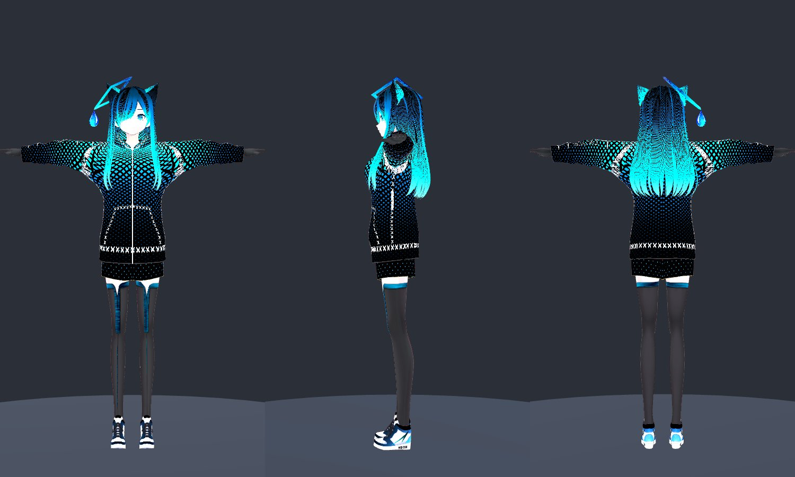 | 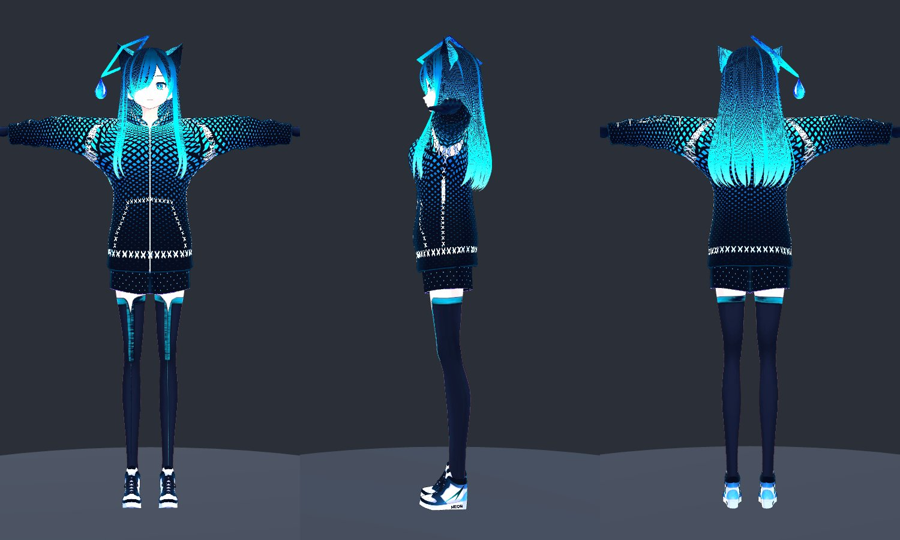 |

### 1.4 Animations : un retargeting propre à la production
- Les clips UAL sont **précalculés une fois** sous une forme indépendante du squelette : pour chaque os humanoïde VRM, la rotation monde par rapport à la pose en T, à 30 images/s. Fichier : `public/assets/animations/ual-humanoid-clips.json`.
- Au chargement, `src/cyberverse/characters/humanoidClips.js` les convertit pour les **os normalisés** de n'importe quel VRM (0.x ou 1.0). Il utilise la vraie hiérarchie du modèle, ce qui marche avec ou sans `upperChest`.
- **Ancrage des pieds au sol (nouveau).** Les jambes des VRM n'ont pas les proportions du mannequin UAL : avant correction, les chaussures s'enfonçaient de 1,2 cm au repos et jusqu'à 5,5 cm accroupi. Le module évalue chaque clip sur le modèle, mesure des points de semelle (talon, plante, pointe) et corrige la hauteur des hanches :
  - image par image pour les clips au sol ;
  - par un décalage constant pour les sauts ;
  - pas de correction pour la roulade.
- **Effet secondaire réglé.** Le footing de la UAL fait rebondir les hanches de 24,5 cm à 2,1 Hz, plus que la gravité. Les longs cheveux de NEON FIGHTER + passaient alors par-dessus sa tête. Avec l'ancrage image par image, le rebond suit la géométrie réelle des jambes et les cheveux restent naturels. Les réglages de ressorts d'origine sont conservés : je les avais d'abord modifiés, mais les tests ont montré que ce n'était pas la cause, et je suis revenu en arrière.
- **21 clips sans violence**, car la licence de Cyber JT interdit l'expression violente : Idle, Idle_Talking, Walk, Walk_Formal, Jog, Sprint, Jump (début, boucle, réception), Crouch (repos, marche), Interact, PickUp, Push, Sitting (entrée, repos, conversation, sortie), Roll, Dance, Fixing_Kneeling.

### 1.5 Optimisation sans perte visible
| | Cyber JT | NEON FIGHTER + |
|---|---|---|
| Taille du fichier | 15,55 → **3,53 Mo** (−77 %) | 17,86 → **4,88 Mo** (−73 %) |
| Morph targets (57 expressions), stockés en accessors creux, sans perte | 5,77 → 0,65 Mo | 5,76 → 0,60 Mo |
| Textures | PNG → WebP (`EXT_texture_webp`) ; peau du corps 2048 → 1024 (cachée par les vêtements) ; vignette 2048 → 512 ; cartes d'émission 2K en demi-résolution | idem ; peau et manchettes 2048 → 1024 |
| Mémoire GPU des textures (estimation, RGBA décompressé) | 114,7 → 136,7 Mo (nouvelles cartes d'émission et pantalon en 2K) | 150,6 → 142,6 Mo |
| Triangles | 36 377 (inchangé) | 41 964 → 41 956 |

La comparaison des gros plans de visage avant et après ne montre aucune dégradation (`12-cyber-jt-cv-face.jpg`, `22-neon-fighter-cv-face.jpg`).

## 2. Validation sur les copies de production
Tous les tests ont été exécutés **sur les fichiers de `public/assets/`** dans Microsoft Edge headless, sur le GPU de la machine (Intel UHD Graphics, D3D11), avec **les modules de l'application** : `src/cyberverse/characters/character.js` et `humanoidClips.js`. Les ressorts des cheveux et accessoires étaient actifs, et `vrm.update(dt)` tournait à 60 pas/s.

| Test | Cyber JT | NEON FIGHTER + |
|---|---|---|
| Chargement VRM (three-vrm 3.1.0), métadonnées et licence | ✔ VRM 0.x, « cv-1.0 » | ✔ VRM 0.x, « cv-1.0 » |
| Rendu face / profil / dos, gros plans visage et cheveux | ✔ | ✔ |
| Transparence et matériaux | ✔ aucun défaut | ✔ aucun défaut (goutte nette) |
| Os humanoïdes pilotés | 52 / 52 essentiels | 52 / 52 essentiels |
| Clips construits | 21 | 21 |
| Repos : point le plus bas des chaussures | 0,0 cm | −0,1 cm |
| Marche : point le plus bas (min / médiane / max) | −0,2 / 0,0 / +0,7 cm | +0,1 / +0,3 / +0,4 cm |
| Footing | −2,6 / −0,2 / +0,8 cm | −3,5 / +0,1 / +0,9 cm |
| Sprint | −4,5 / −0,1 / +2,6 cm | −4,8 / −0,3 / +3,9 cm |
| Accroupi en marche | −0,1 / 0,0 / +0,8 cm | −0,1 / +0,2 / +0,9 cm |
| Déformations (coudes, épaules, genoux, en course) | ✔ pas de déchirure ni de vêtement qui traverse | ✔ |
| Performance, chemin de production (marche, 1280×720, ressorts actifs) | **0,93 ms/image** (mise à jour 0,59 ms), 23 draw calls, 53 631 triangles | **1,74 ms/image** (mise à jour 1,17 ms), 29 draw calls, 78 506 triangles |
| Chargement local (VRM + construction et ancrage des 21 clips) | 0,44 s | 0,43 s |

Le « point le plus bas » est le sommet réel le plus bas des chaussures, calculé par skinning CPU sur le maillage. Le sol est à 0.

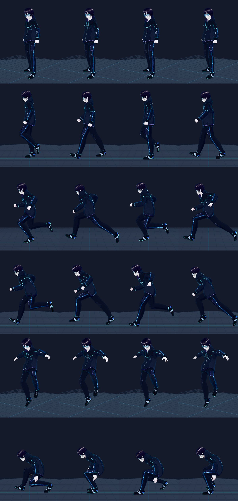
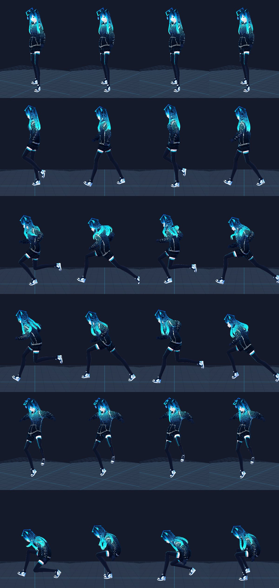
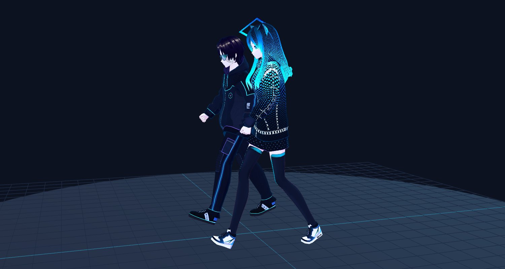
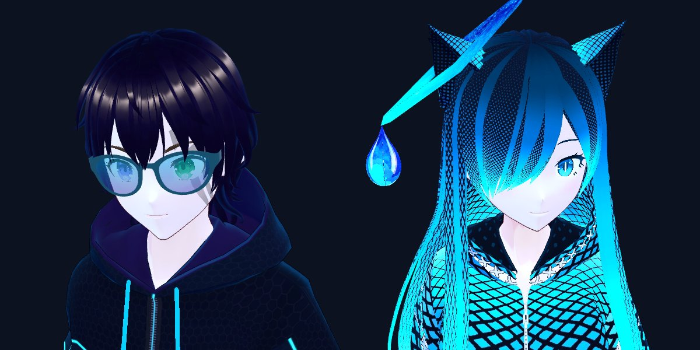

## 3. Limites restantes, consignées honnêtement
1. **Footing et sprint.** L'ancrage image par image supprime les phases en l'air : un pied touche toujours le sol, ce qui rend la course un peu moins bondissante que dans la UAL. Il reste de brefs enfoncements de la pointe de chaussure, de 2,6 à 4,8 cm, sur une seule image au moment de la poussée.
2. **Jump_Loop** se joue sur place : les pieds sont 0 à 7 cm au-dessus du sol. C'est normal, puisque c'est le contrôleur de saut qui portera le personnage.
3. **Pas de virages ni de pas latéraux** dans la UAL : la rotation devra être gérée par code.
4. **Pas de halo lumineux (bloom).** Les lignes émissives sont vives mais sans halo. Il faudra un bloom dans le rendu de la ville (par exemple `UnrealBloomPass`).
5. Il reste une très légère trace du motif tribal d'origine sur les flancs du sweat de Cyber JT, visible seulement de profil et de près.
6. **Compatibilité.** Les VRM de production exigent l'extension `EXT_texture_webp`. Three.js et les navigateurs actuels la gèrent, mais UniVRM et VRoid Studio peuvent ne pas ouvrir ces copies. Les originaux intacts servent pour ces outils.
7. **Performance** mesurée sur une seule machine (GPU intégré Intel, Edge). Mobile non testé.
8. **Pas encore d'application.** Les modules de `src/cyberverse/characters/` sont prêts mais pas encore branchés : le dépôt n'a ni `package.json` ni bundler. Versions testées et à installer : `three@0.169.0` et `@pixiv/three-vrm@3.1.0`.
9. **Blender 5.3** n'a pas servi aux modifications de la Phase 2C. Le pipeline Three.js modifie le VRM directement et sans perte (MToon, ressorts, expressions, métadonnées de licence conservés). Un aller-retour par Blender aurait demandé un add-on VRM et fait courir un risque sur ces données. Blender a servi en Phase 2B pour une vérification croisée.
10. **Rien n'est commité ni publié.** Commiter `public/assets/` publierait les deux VRM (8,4 Mo) et le JSON. Les licences le permettent : redistribution autorisée pour les deux modèles, UAL en CC0. La décision vous revient.

## 4. Licences et attribution
| Élément | Auteur | Licence et conditions | Crédit |
|---|---|---|---|
| Cyber JT | Jonh Tinoco (VRoid Hub) | Usage commercial (personnel et entreprise) ✔ ; modification ✔ ; redistribution ✔ ; **expression violente ✘, sexuelle ✘** | Non requis, donné quand même |
| NEON FIGHTER + | Kanato (VRoid Hub) | Usage commercial ✔ ; modification ✔ ; redistribution ✔ ; aucune restriction de contenu | Non requis, donné quand même |
| Animations | Quaternius, Universal Animation Library | CC0 1.0 | Non requis, donné quand même |

Les conditions sont inscrites dans les métadonnées `vrm_meta` des deux fichiers de production. Le titre, la version, l'auteur (« original ; CYBERVERSE edit ») et le lien vers l'original y ont été mis à jour. Détails dans `public/assets/characters/CREDITS.md` et `public/assets/animations/CREDITS.md`. Côté code, `src/cyberverse/characters/characters.js` liste les URL, crédits et restrictions, dont `no-violence` pour Cyber JT.

## 5. Reproduire
Tout est reproductible à partir des originaux, avec Node.js et Edge, sans installer de dépendance. Voir `tools/char-lab/README.md` :
- `studio/build.html` avec les recettes `cyber-jt` et `neon-fighter` → VRM de production ;
- `studio/bake-clips.html` → clips ;
- `lab.html`, `anim-test.html` et `lineup.html` → validation.
