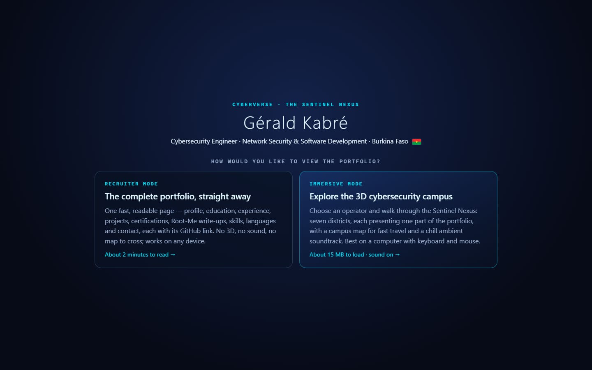
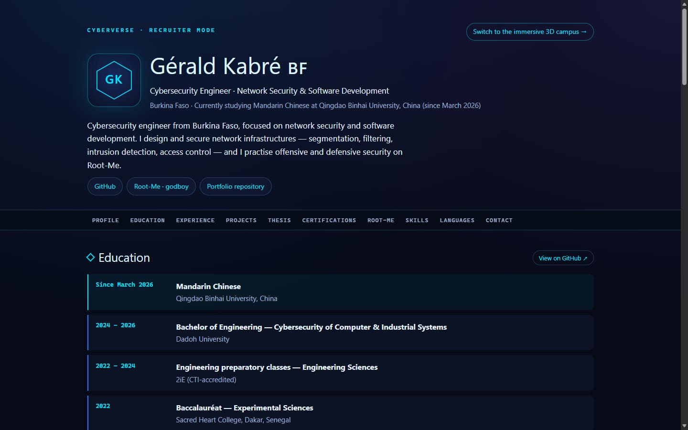
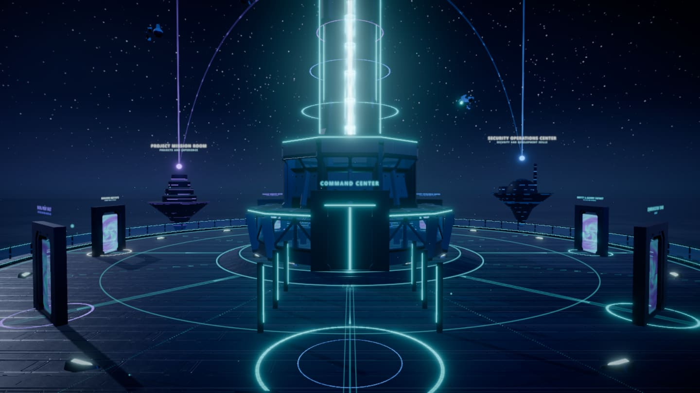
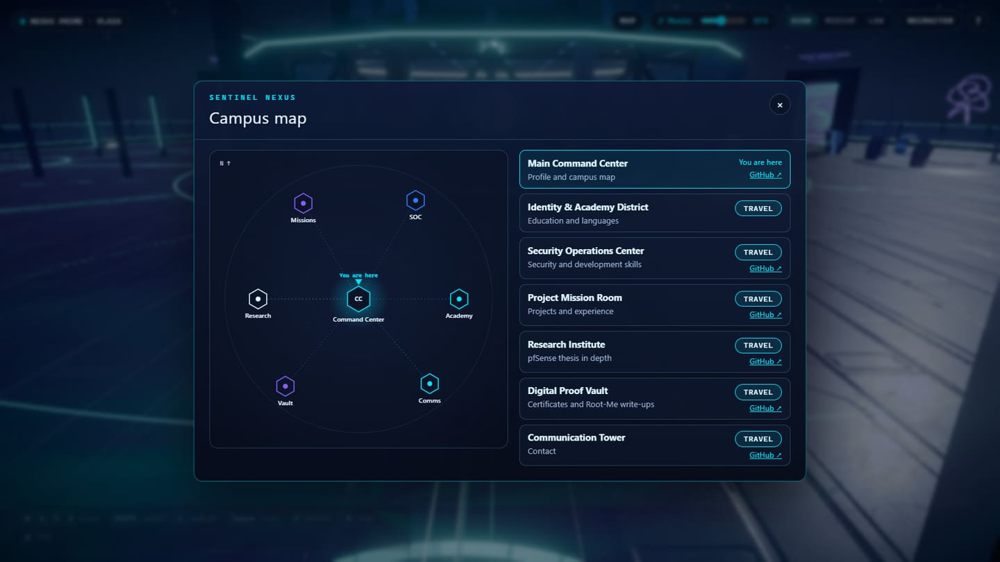
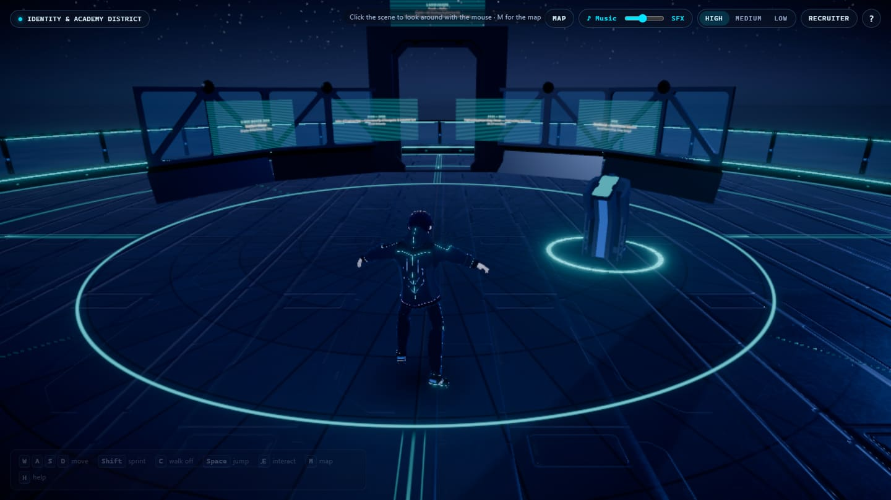
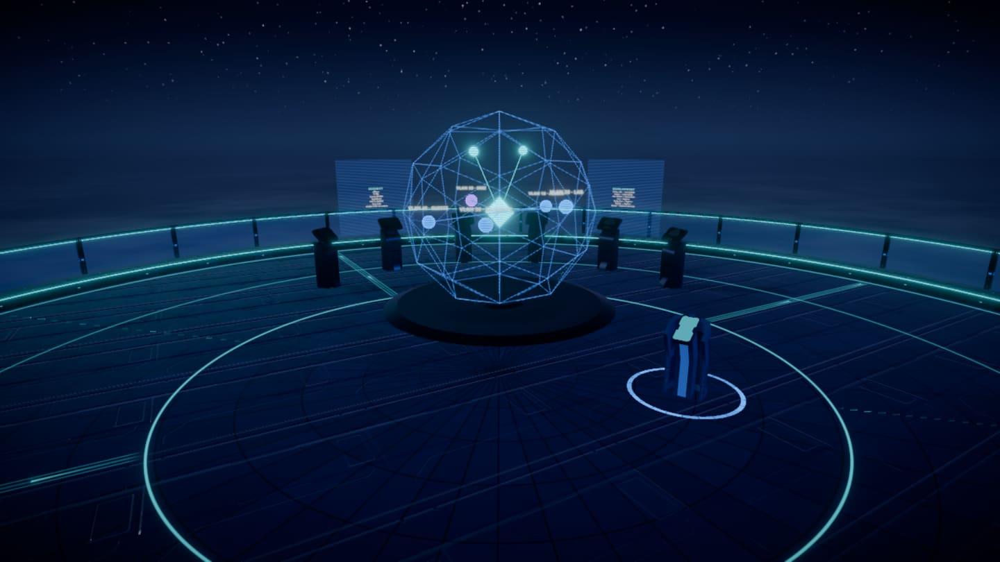
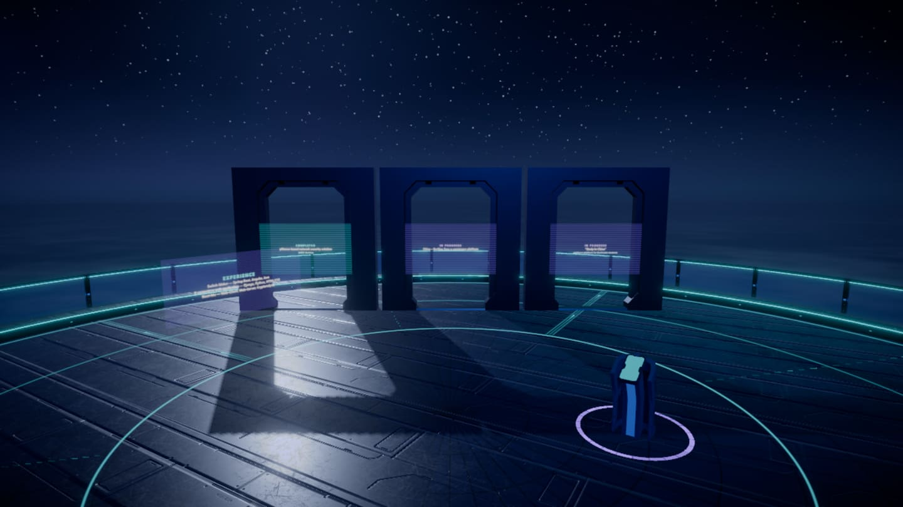
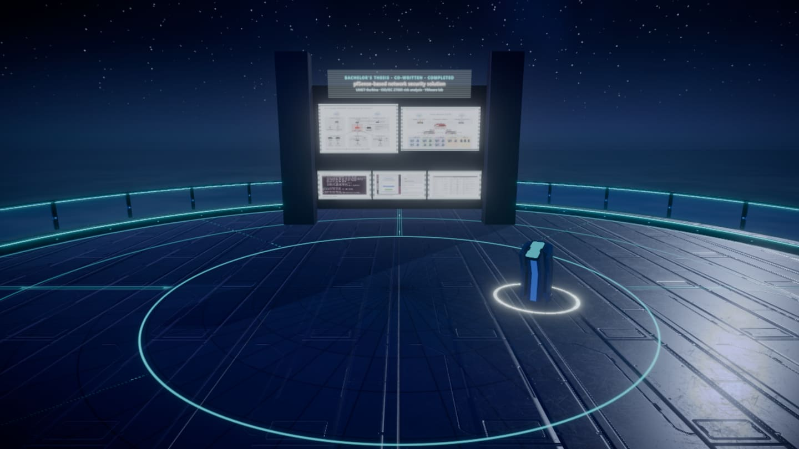
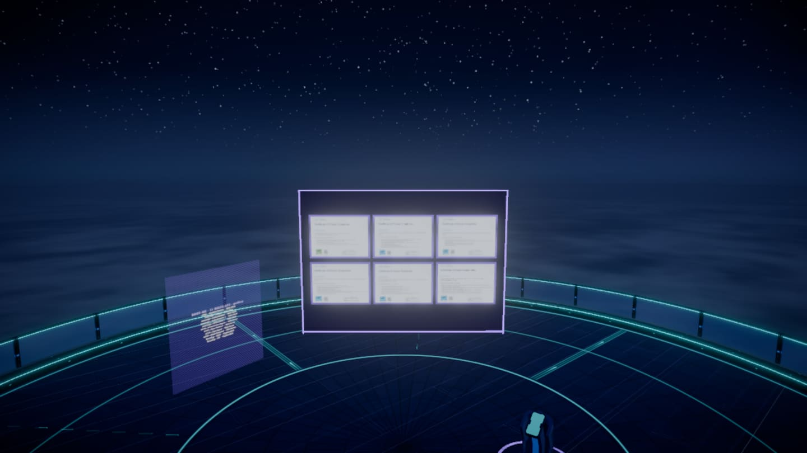
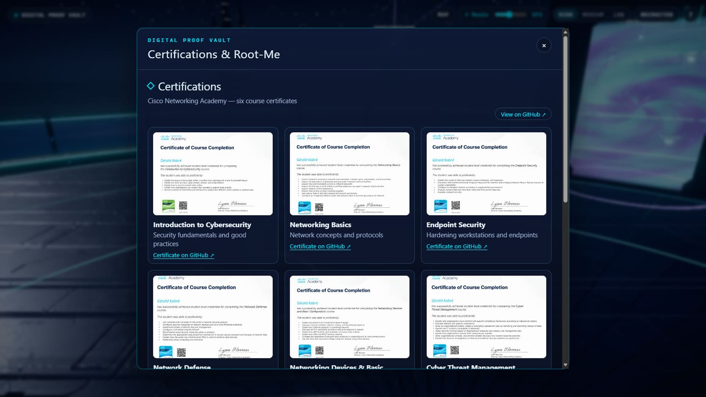

# CYBERVERSE — Finalisation du site

Date : 22/11/2026 · Branche `feature/cyberverse-foundation` (commits locaux, rien n'est poussé ni déployé)
Voir aussi `ARCHITECTURE.md` et `MILESTONE_3_REPORT.md`.

## 1. Ce que le visiteur trouve

**Écran d'accueil : le choix du mode.** Avant tout téléchargement 3D, le visiteur choisit l'un des deux modes. Chacun est expliqué à l'écran.

| Mode | Contenu |
|---|---|
| **Mode recruteur** (`/recruiter/`) | Tout le portfolio sur une page rapide : profil, formation, expérience, projets, mémoire, certifications, Root-Me, compétences, langues, contact. Ni 3D ni son. Chaque partie a son lien GitHub. |
| **Mode immersif** | Le campus 3D : choix de l'opérateur, puis sept districts, une carte avec voyage rapide et une musique d'ambiance. |

| | |
|---|---|
|  |  |
|  |  |

**Les sept districts.** Chaque district présente une partie du portfolio, avec un terminal (touche E) qui ouvre le panneau détaillé et ses liens GitHub.

| District | Partie présentée | En 3D |
|---|---|---|
| Main Command Center | Profil | Rotonde, flèche, table holographique (dossier) |
| Identity & Academy | Formation (2022 → mars 2026) et langues | Galerie vitrée, quatre plaques datées, panneau des langues |
| Security Operations Center | Compétences sécurité et développement (avec niveaux) | Hologramme du réseau pfSense (pare-feu, cinq VLAN, Dual-WAN), consoles |
| Project Mission Room | Projets (statut « terminé » ou « en cours ») et expérience | Trois baies de mission, panneau d'expérience |
| Research Institute | Mémoire pfSense en détail | Écrans avec les vrais schémas avant/après et les captures de tests |
| Digital Proof Vault | Certifications Cisco et write-ups Root-Me | Monolithe avec les six vrais certificats, tableau des 11 write-ups |
| Communication Tower | Contact | Tour d'antennes, panneau des canaux de contact |

| | |
|---|---|
|  |  |
|  |  |
|  |  |

**Navigation**
- **Anneau de six portails** autour du Command Center. Chaque portail est aligné sur son district, et les voies lumineuses du sol y mènent.
- **Portail de retour** sur chaque île.
- **Carte du campus** (touche M ou bouton « Map ») :
  - position actuelle (« You are here ») ;
  - voyage rapide en un clic ;
  - rôle de chaque district et lien GitHub.

**Musique**
- Bande-son *chill cyber* générée en direct avec la Web Audio API : nappes, basse douce, notes égrenées, pulsation lente, texture.
- C'est une création originale : aucun fichier audio, aucune licence en jeu.
- Volume bas par défaut, montées et baisses progressives.
- Coupée quand l'onglet est caché.
- Réglages musique/SFX et curseur de volume, mémorisés.
- Elle démarre au clic sur « Mode immersif », qui est un geste de l'utilisateur. Le mode recruteur reste silencieux.

## 2. Fluidité des déplacements (retour « mouvements pas fluides »)

1. **Physique à pas fixe** (60 Hz) avec interpolation à l'affichage : le mouvement ne saccade plus quand la durée des images varie.
2. **Caméra** :
   - suivi serré de la position interpolée ;
   - elle se replace doucement derrière le personnage quand on avance sans toucher à la souris (pratique au clavier seul).
3. **Plus d'allocations mémoire à chaque image**, qui provoquaient des pauses du ramasse-miettes.
4. **Résolution adaptative avec hystérésis** : la résolution ne baisse qu'au-delà de 21 ms par image, ne remonte qu'après 8 s confortables, avec un délai de 12 s entre deux changements. Elle n'oscille plus, alors que chaque changement provoquait une saccade.
5. **Corrigé** : animation de réception de saut jouée à tort après une téléportation.

## 3. Contenu

- Mise à jour d'après tes notes du 22/11/2026 :
  - formation datée, dont Dadoh University (2024–2026) et le chinois depuis mars 2026 ;
  - Switch Maker (3 mois) ;
  - application e-commerce Django déployée sur Render ;
  - méthode du mémoire en 4 phases (ISO/IEC 27005) ;
  - niveaux en développement ;
  - anglais B2 (Duolingo 110).
- Liens GitHub pour chaque partie : projets, mémoire (page et PDF), chaque certificat, chaque write-up Root-Me, compétences, dépôt.
- **Pas de CV**, à ta demande : le bouton et le PDF généré ont été retirés.
- **E-mail** :
  - il n'est pas écrit dans le code ; il vient de la variable `VITE_CONTACT_EMAIL` (voir `.env.example`) ;
  - à définir dans `.env.local` en local et dans les variables d'environnement Netlify ;
  - sans elle, les liens e-mail sont masqués.
- **Photo** :
  - aucune photo n'existe dans le dépôt ni dans son historique, et l'avatar GitHub est l'icône par défaut ;
  - un monogramme « GK » est affiché à la place ;
  - déposer `public/assets/profile/photo.jpg` le remplace partout au prochain build.

## 4. Vérifications (version de production, Edge, vrai GPU Intel UHD)

| Test | Résultat |
|---|---|
| Bout en bout, NEON FIGHTER + | **32 / 32**, dont : portail → Académie, terminal, retour, carte → Vault, liens GitHub, terminaux des 6 districts |
| Bout en bout, Cyber JT | **32 / 32** |
| Interface | **17 / 17** : écran de choix (aucun fichier 3D avant le choix), musique active après le clic, sélection à la souris, aide, qualité, redimensionnement, mouvements réduits |
| Mode recruteur | 9 sections, 32 liens GitHub, aucune erreur, pas de débordement en largeur téléphone |
| Course scriptée de 12 s (haute, 1600×900, résolution adaptative) | 63,5 et 64,6 i/s en moyenne |
| Résolution fixe, 1600×900 | Haute 33 i/s · Moyenne 37 i/s · Basse 43,8 i/s |

Limites connues :
- la musique n'a pas été écoutée : un test sans affichage ne peut vérifier que le moteur audio ;
- le verrouillage du pointeur n'est pas testable sans affichage ;
- il n'y a pas de commandes tactiles : sur mobile, le mode recruteur est recommandé, et l'écran d'accueil le présente en premier.

## 5. Déploiement (avec ton accord)

`netlify.toml` est prêt :
- build `npm run build`, publication de `dist` ;
- redirection `/recruiter` → `/recruiter/` ;
- en-têtes de sécurité, cache des assets.

L'image de partage `public/og-image.jpg` est générée à partir d'un vrai rendu. Il reste à pousser la branche et à relier le dépôt à Netlify, avec ton accord.
