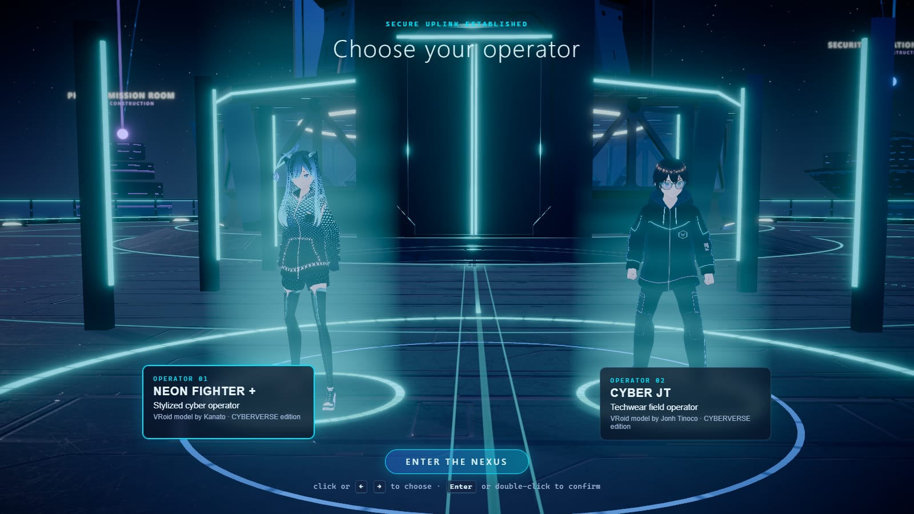
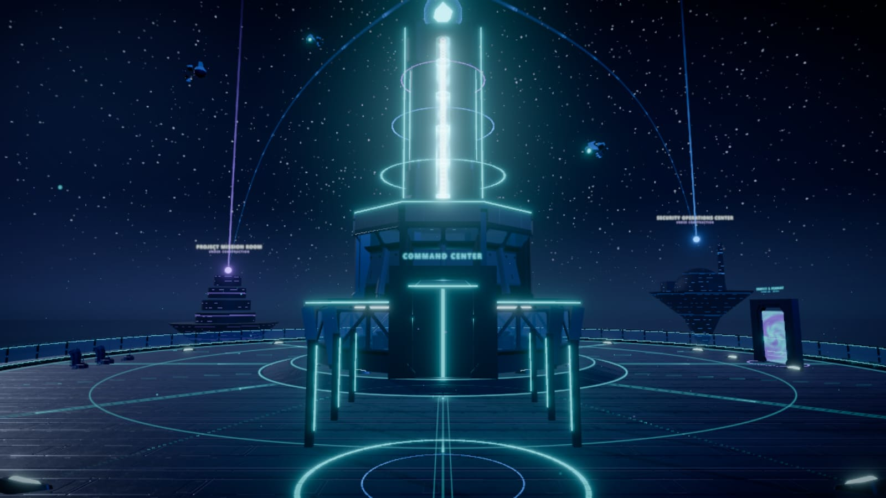
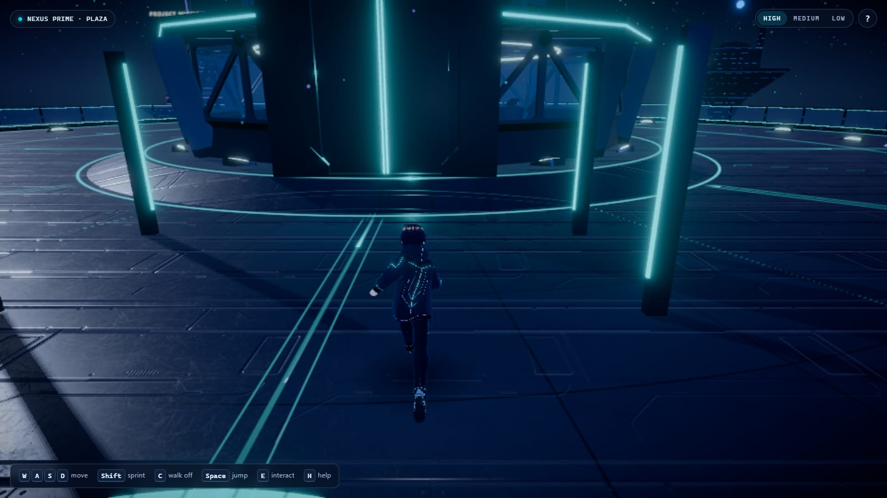
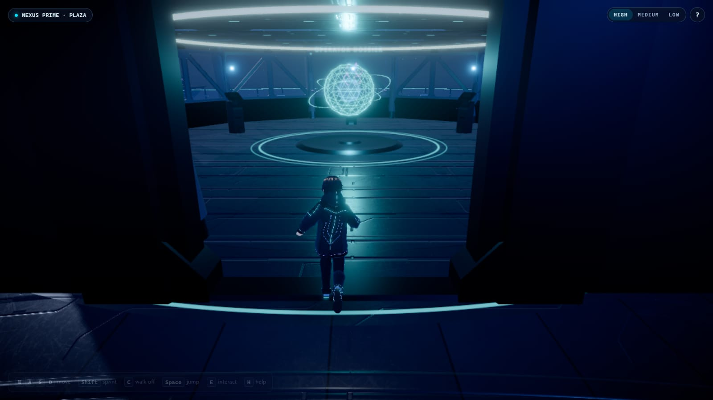
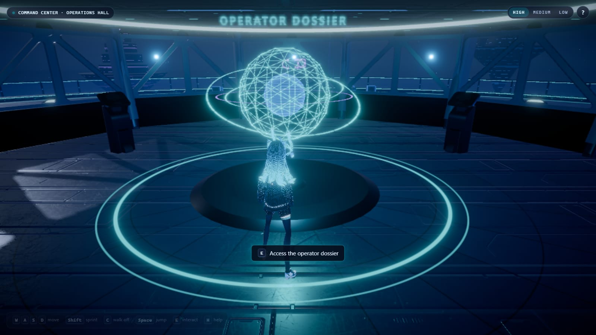
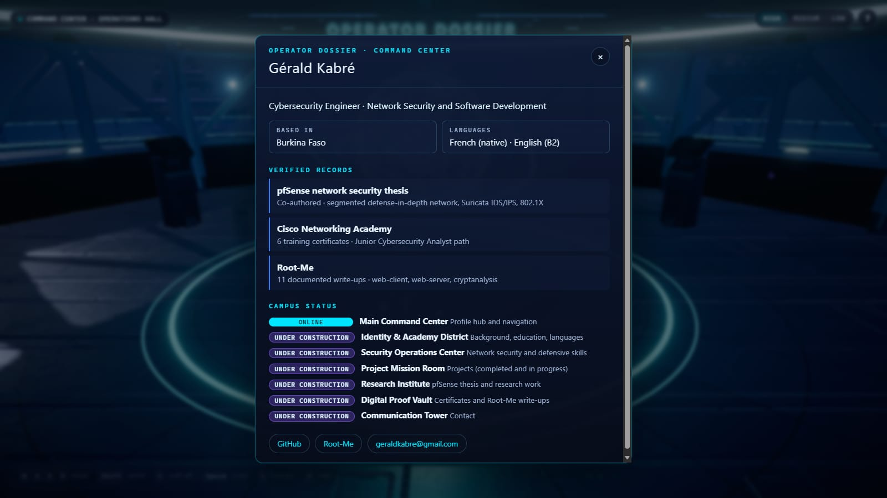
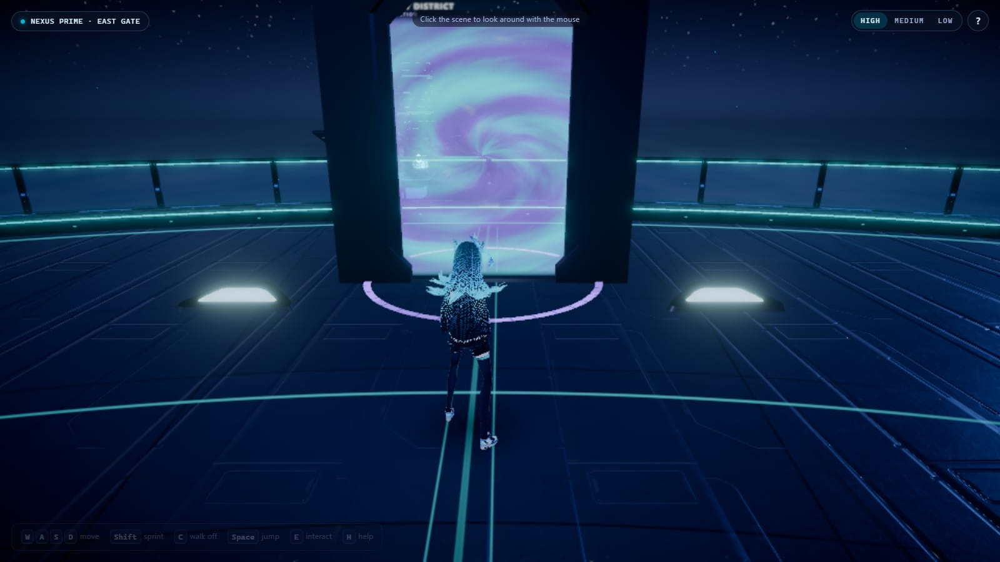
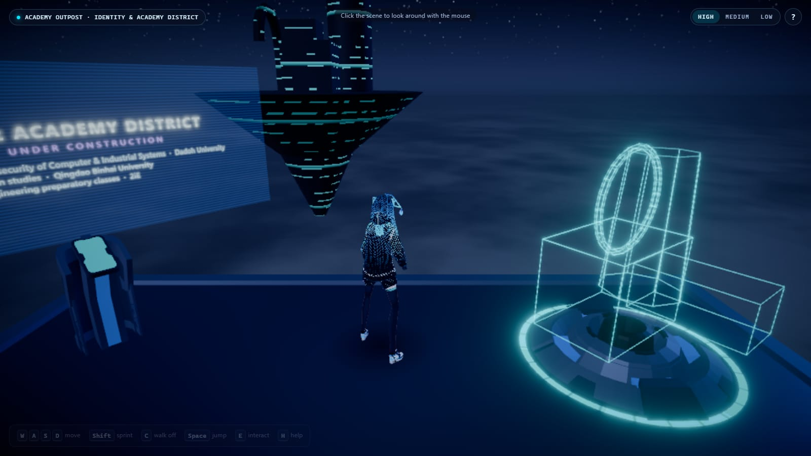

# CYBERVERSE — Jalon 3 : premier monde jouable (Nexus Prime)

Date : 22/11/2026 · Branche : `feature/cyberverse-foundation` · Architecture : voir `ARCHITECTURE.md`

## 1. Résultat

Une île flottante, **Nexus Prime**, entièrement jouable dans le navigateur :
- un **Command Center** en rotonde ;
- les **deux personnages validés** (NEON FIGHTER + et Cyber JT) ;
- un écran de sélection ;
- un contrôle à la troisième personne ;
- trois destinations interactives.

Tout a été testé dans la **version de production** (`npm run build` puis `npm run preview`), avec Microsoft Edge en mode sans affichage sur le vrai GPU (Intel UHD), de vraies touches et une vraie souris.

| | |
|---|---|
|  |  |
| Sélection : les deux opérateurs, éclairés, face caméra | Le Command Center depuis l'avenue d'arrivée |
|  |  |
| Course de Cyber JT vers le Command Center | Porte automatique ouverte, hall des opérations |
|  |  |
| Table holographique : message d'interaction | Dossier de l'opérateur (touche E) |
|  |  |
| Portail Est vers l'Académie | Arrivée sur l'avant-poste, district de l'Académie en vue |

Autres captures dans `images/milestone3/` : chargement, sprint, marche, panneau du district, vue aérienne, largeur téléphone.

## 2. Le monde

**Direction artistique**
- Nuit marine, accents cyan et bleu électrique, touches de violet, sans excès de néon.
- Les lignes lumineuses ont toutes un rôle :
  - guidage (avenue, voies de données du sol) ;
  - architecture (corniches, nervures de la flèche) ;
  - interaction (portails, hologrammes).

**Composition** (nord en haut)
- **Arrivée** (sud) : anneaux lumineux au sol ; c'est le point de départ des deux opérateurs.
- **Avenue** bordée de six lames lumineuses, menant à la **porte monumentale** du Command Center.
- **Command Center**, éléments du MegaKit à l'échelle 1,25 :
  - rotonde vitrée à 12 côtés, éclairée de l'intérieur ;
  - tambour blindé à 8 côtés avec claire-voie ;
  - flèche de 15 m autour d'un cœur d'énergie, trois anneaux holographiques, « œil » sentinelle, faisceau vers le ciel.
- **Hall des opérations** : table holographique (globe, orbites) et cinq consoles.
- **Porte Est** : portail animé vers l'**avant-poste de l'Académie**. C'est une plateforme flottante du Cyberpunk Kit, avec un panneau d'information, une maquette filaire du futur district et un portail de retour.
- **Cour technique** (nord) et **belvédère** (ouest) : antennes, écrans, consoles.
- **Coque suspendue** à étages, avec équipements et un noyau de gravité lumineux.
- **Horizon** :
  - six districts lointains en silhouette, chacun avec balise et étiquette (« en construction »), reliés à la flèche par des **flux de données** animés ;
  - mer de nuages, ciel étoilé, nébuleuse et lune.
- **Vie** : trois drones sentinelles en patrouille, particules de données, pulsations dans les voies du sol.

**Assets**
- MegaKit : 12 pièces ; Cyberpunk Kit : 14 pièces. Seules les pièces utilisées sont livrées.
- Les matériaux sont recréés : acier marine, et marquages rouges d'origine remplacés par des accents pilotés par les masques du kit.
- Le reste est procédural : pont et coque, shaders du ciel, des nuages, des hologrammes, des portails et des flux.

## 3. Critères d'acceptation du jalon 3

| Critère | Statut | Preuve |
|---|---|---|
| L'application démarre | ✔ | Build de production et preview. Sélection affichée en 2,3 s (serveur local). |
| Le monde 3D s'affiche dans un vrai navigateur | ✔ | Edge, vrai GPU, captures ci-dessus. |
| Les deux vrais personnages se chargent | ✔ | Les deux VRM de production sont affichés à la sélection. Le personnage non choisi est ensuite libéré de la mémoire. |
| La sélection fonctionne | ✔ | Flèches, clic, puis Entrée, double-clic ou bouton. 2 × 25 + 14 vérifications. |
| Caméra à la troisième personne | ✔ | Suivi lissé, collision testée : caméra maintenue dans le hall. |
| Déplacement ZQSD/WASD | ✔ | Touches à la position physique (ZQSD en AZERTY) et flèches. 18–27 m parcourus dans le test. |
| Contrôle de la caméra à la souris | ✔ partiel | Glisser-déplacer vérifié. Le verrouillage du pointeur est codé mais **non vérifiable** en mode sans affichage. |
| Animations repos, marche, course | ✔ | `Idle_Loop`, `Walk_Loop` (1,5 m/s), `Jog_Fwd_Loop` (4,3 m/s), `Sprint_Loop` (6,8 m/s), lues à vitesse calée. Saut en plus. |
| Composition cohérente de l'environnement | ✔ (avis) | Captures ; jugement à confirmer par vous. |
| Au moins une destination interactive | ✔ | Porte automatique, dossier (E), portail aller-retour, panneau du district (E). |
| Pas d'erreur critique dans la console | ✔ | Aucune erreur dans les trois scénarios. |
| Performances mesurées | ✔ | Voir §4. |
| Captures du résultat réel | ✔ | `images/milestone3/` (16 images, 1,25 Mo). |

## 4. Performances mesurées

Conditions : version de production, Edge sans affichage, **GPU Intel UHD intégré**, vue fixe depuis l'arrivée, personnage au repos.

| Résolution | Préréglage | Échelle de rendu fixe | Avec résolution adaptative (échelle atteinte) |
|---|---|---|---|
| 1600×900 | Haute | 32,3 i/s | **63,8 i/s** (0,60) |
| 1600×900 | Moyenne | 37,9 i/s | **62,7 i/s** (0,65) |
| 1600×900 | Basse | 41,3 i/s | — |
| 1280×720 | Haute | 48,1 i/s | **58,5 i/s** (0,80) |
| 1280×720 | Moyenne | 53,4 i/s | **60,8 i/s** (0,85) |
| 1280×720 | Basse | 64,7 i/s | — |

**Course scriptée de 12 s** (haute, 1600×900, résolution adaptative) : entre 57,2 et 65,8 i/s en moyenne sur quatre exécutions ; la mesure varie avec la charge de la machine. p95 de 21–27 ms, p99 de 28 ms. 58 à 65 appels de rendu, 83 000 à 108 000 triangles.

**Gains obtenus pendant le jalon**, haute qualité, échelle fixe 1600×900 : de 22,8 à 32,3 i/s. Les causes ont été identifiées par mesure :
- ombres : environ 12 ms par image, passées en carte statique ;
- appels de rendu : de 264 à 106 dans cette vue ;
- trois lumières ponctuelles supprimées ;
- ciel et nuages précalculés ;
- bloom à demi-résolution.

**Volumes**

| Élément | Taille |
|---|---|
| Interface | 74 Ko compressés |
| Moteur | 306 Ko compressés, chargé après l'affichage de l'écran de chargement |
| Premier chargement, qualité haute | ≈ 15 Mo bruts, ≈ 9,6 Mo transférés avec gzip |
| Premier chargement, qualité moyenne | ≈ 6,7 Mo transférés |
| Les deux personnages (sélection) | 8 Mo bruts |

## 5. Décisions importantes (résumé)

1. **Moteur impératif et React pour l'interface seule**, sans React Three Fiber : une seule boucle maîtrisée. Le futur mode recruteur n'embarquera pas le moteur.
2. **Versions validées conservées** : Three.js r169 et three-vrm 3.1.0 ont été validés avec les personnages en Phase 2C.
3. **Ombres statiques et ombre de contact** pour les personnages : le meilleur rapport qualité/coût sur GPU intégré.
4. **Résolution adaptative et qualité par défaut selon le GPU** : 60 i/s visés partout, au prix d'une image plus douce sur les petits GPU.
5. **Murs du MegaKit orientés face détaillée vers l'extérieur** et rendus double face : ce sont des panneaux d'intérieur à une seule face.
6. **Portails espacés des points d'arrivée** : la caméra ne doit jamais traverser la surface du portail (défaut corrigé pendant les tests).
7. **Sélection à la souris** : le survol ne change plus le choix ; le clic choisit, la validation est explicite (défaut trouvé par le test d'interface).

## 6. Limites et travail restant (honnêtement)

1. **Performances sur ce PC** : sans résolution adaptative, la qualité haute plafonne à environ 32 i/s en 1600×900. Les 60 i/s ne sont atteints qu'en réduisant l'échelle de rendu à 0,6–0,7, ce qui donne une image plus douce. Les mesures sont faites en mode sans affichage ; un écran à densité 1,25–1,5 représente plus de pixels.
2. **Verrouillage du pointeur** : il n'a pas pu être vérifié en mode sans affichage. À tester à la main : un clic dans la scène, puis Échap.
3. **Mobile** : aucune commande tactile (jalon 8). La mise en page en largeur téléphone a seulement été vérifiée à l'œil.
4. **Districts lointains** : ce sont des silhouettes provisoires, à remplacer au jalon 5.
5. **Absent ce jalon, comme prévu** :
   - séquence de démarrage cinématique, survol de caméra, GSAP (jalon 4) ;
   - mode recruteur (jalon 6) ;
   - musique (jalon 7).
6. **Animations** :
   - la bibliothèque UAL n'a ni virage sur place ni pas chassé : la rotation est faite par code ;
   - le saut utilise `Jump_Loop` et `Jump_Land`, sans élan de départ.
7. **Ombres statiques** : les portes coulissantes et les drones ne projettent pas d'ombre. L'avant-poste est hors de la carte d'ombre.
8. **Textures des personnages** : environ 140 Mo de mémoire GPU estimée par personnage (Phase 2C). Les deux sont chargés pendant la sélection. Une compression KTX2 est prévue au jalon 8 ; l'encodeur n'est pas disponible localement.
9. **Contenu à confirmer par vous** : la formation affichée reprend votre brief. Le README du dépôt indique « UMET Burkina, ISTI » pour la licence ; le brief indique « Bachelor of Engineering… Dadoh University ». J'ai utilisé la formulation du brief. **Merci de confirmer l'intitulé exact.**
10. **Pas de photo** : la photo professionnelle n'existe pas dans le dépôt. Elle sera nécessaire au jalon 6.

## 7. Fichiers

- **Application** : `index.html`, `src/` (app, engine, game, world, content), `vite.config.ts`, `tsconfig.json`, `package.json` et `package-lock.json`.
- **Assets** :
  - `public/assets/environments/` : kits, textures, manifestes, `CREDITS.md` ;
  - personnages et animations de la Phase 2C, inchangés.
- **Outils** : `tools/env-build/`, `tools/e2e/`, `tools/world-viewer/`, `tools/kit-viewer/`.
- **Originaux** : `assets-source/` est intact, et toujours exclu de Git.
